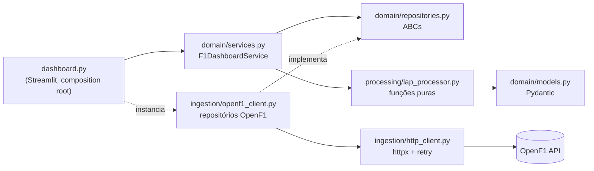

# Arquitetura

O código é organizado em camadas. A regra de dependência é
**UI → Domain ← Ingestion / Processing**: o domínio define modelos e contratos e não
conhece HTTP, Streamlit ou a OpenF1.



## Camadas

| Camada | Módulo | Responsabilidade |
|---|---|---|
| UI | `dashboard.py` | Monta as dependências, renderiza a página e faz cache |
| Domain | `domain/models.py` | `Meeting`, `Session`, `Driver`, `Lap`, `FastestLapEntry`, `SessionOverview`, `Stint`, `Weather` |
| Domain | `domain/repositories.py` | Contratos `MeetingRepository`, `SessionRepository`, `DriverRepository`, `LapRepository` |
| Domain | `domain/services.py` | `F1DashboardService`: orquestra repositórios e processamento |
| Processing | `processing/lap_processor.py` | Filtra voltas válidas, indexa pilotos, calcula ranking e médias |
| Ingestion | `ingestion/http_client.py` | `HttpClient` com timeout, retry exponencial e filtros OpenF1 |
| Ingestion | `ingestion/openf1_client.py` | Implementações concretas dos repositórios |
| Utils | `utils/config.py`, `utils/logger.py` | Configuração via `.env` e logging estruturado |

## Injeção de dependência

`F1DashboardService` recebe os quatro repositórios pelo construtor. Em produção, o
`dashboard.py` injeta as implementações OpenF1; nos testes unitários entram
`MagicMock`s, sem rede.

```python
http_client = HttpClient(base_url=settings.base_url, timeout=settings.timeout)
service = F1DashboardService(
    meeting_repository=OpenF1MeetingRepository(http_client),
    session_repository=OpenF1SessionRepository(http_client),
    driver_repository=OpenF1DriverRepository(http_client),
    lap_repository=OpenF1LapRepository(http_client),
)
```

## Decisões técnicas

**Cliente HTTP.** `httpx` com até 3 tentativas e backoff exponencial
(0,5 s, 1 s) em timeout, erro de transporte, `429` e `5xx`. Outros `4xx` falham na
hora. A OpenF1 responde `404` quando o filtro não encontra registros; isso vira lista
vazia.

**Filtros com operadores.** A query string é montada por `build_query` para
preservar os operadores da OpenF1 (`speed>=315`, `lap_duration<90`), que o `httpx`
codificaria dentro da chave. Use `Filter("speed", ">=", 315)`.

**Validação resiliente.** Cada item do payload é validado com Pydantic. Itens
inválidos são ignorados e contados em um log de `WARNING`, sem derrubar a página. Os
modelos são imutáveis e ignoram campos novos da API.

**Ranking de voltas.** Voltas sem `lap_duration` ou com `is_pit_out_lap` são
descartadas. O ranking usa a melhor volta de cada piloto, então o Top 10 mostra dez
pilotos distintos.

**Cache.** O serviço é singleton (`st.cache_resource`) e as consultas ficam em cache
por 1 hora (`st.cache_data`), chaveadas por ano, etapa ou sessão e N.

**Processing a partir do Domain.** O serviço importa as funções de
`processing/`. Elas são puras e dependem apenas dos modelos do domínio, então isso
não acopla o domínio a nenhuma infraestrutura.
